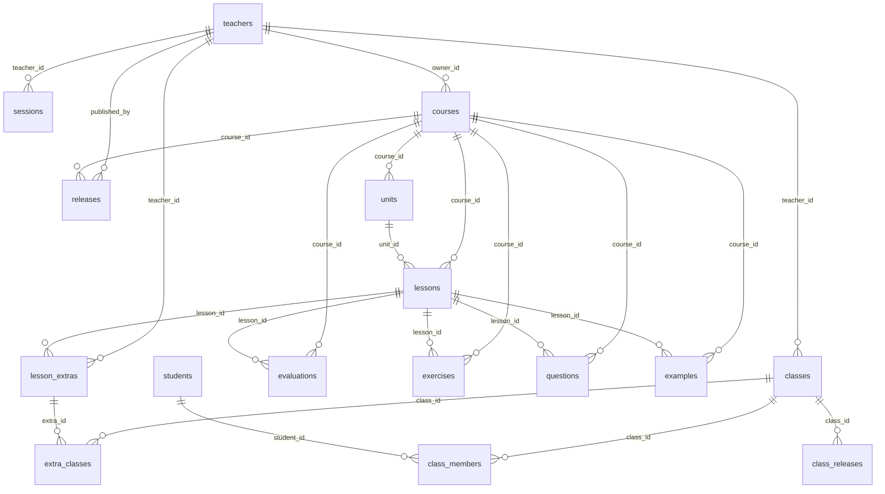

# Modelo de base de datos

Fuente de verdad: `supabase/migrations/` (aplicar en orden).
PostgreSQL de Supabase. La app conecta con el rol `postgres` (salta RLS); la API pública
(`anon`) no puede leer ni escribir: todas las tablas tienen RLS activado y **sin políticas**.

## Diagrama

## Tablas

### `teachers` — docentes

| Columna | Tipo | Notas |
|---|---|---|
| `id` | uuid | PK, `gen_random_uuid()` |
| `name` | text | not null |
| `email` | text | not null, unique |
| `password_hash` | text | not null (scrypt, ver `lib/password.ts`) |
| `role` | text | `admin` \| `maestro`, default `maestro` |
| `created_at` | timestamptz | default `now()` |

### `sessions` — sesiones de login

| Columna | Tipo | Notas |
|---|---|---|
| `token_hash` | text | PK |
| `teacher_id` | uuid | FK → `teachers.id`, on delete cascade |
| `expires_at` | timestamptz | not null |
| `created_at` | timestamptz | default `now()` |

Índice: `sessions_teacher_idx (teacher_id)`.

### `courses` — un curso por docente, más el core

| Columna | Tipo | Notas |
|---|---|---|
| `id` | uuid | PK |
| `key` | text | unique; `base` o 5 caracteres `^[a-z0-9]{5}$` |
| `title` | text | not null |
| `owner_id` | uuid | FK → `teachers.id`, on delete cascade; null solo en el core |
| `is_base` | boolean | default `false` |
| `created_at` | timestamptz | default `now()` |

Reglas: `(key = 'base') = is_base`; `is_base = (owner_id is null)`.
Índice único parcial `courses_single_base (is_base) where is_base`: un solo curso base.

### `units` — unidades del curso

| Columna | Tipo | Notas |
|---|---|---|
| `id` | uuid | PK |
| `course_id` | uuid | FK → `courses.id`, cascade |
| `content_id` | text | id estable del contenido |
| `number` | integer | > 0 |
| `title` | text | not null |
| `description` | text | default `''` |
| `difficulty` | text | `Fundamental` \| `Intermedio` \| `Avanzado` |
| `color` | text | `blue` \| `violet` \| `green` |
| `position` | integer | default 0 |
| `archived_at` | timestamptz | borrado lógico, null = activo |

Unique `(course_id, content_id)`. Índice `units_course_idx (course_id, position)`.

### `lessons` — lecciones

| Columna | Tipo | Notas |
|---|---|---|
| `id` | uuid | PK |
| `course_id` | uuid | FK → `courses.id`, cascade |
| `unit_id` | uuid | FK → `units.id`, **on delete restrict** |
| `content_id` | text | id estable |
| `code` | text | not null |
| `title` | text | not null |
| `eyebrow` | text | default `''` |
| `body` | text | default `''` |
| `code_sample` | text | default `''` |
| `context_title` | text | default `''` |
| `context_body` | text | default `''` |
| `synthesis` | jsonb | array, default `[]` |
| `content` | jsonb | bloques de contenido, default `[]` |
| `position` | integer | default 0 |
| `archived_at` | timestamptz | borrado lógico |

Unique `(course_id, content_id)`. Índice `lessons_course_idx (course_id, unit_id, position)`.

### `evaluations` — evaluación de una lección

| Columna | Tipo | Notas |
|---|---|---|
| `id` | uuid | PK |
| `course_id` | uuid | FK → `courses.id`, cascade |
| `lesson_id` | uuid | FK → `lessons.id`, cascade |
| `content_id` | text | id estable |
| `title` | text | not null |
| `description` | text | default `''` |
| `question_count` | integer | > 0, default 10 |
| `exercise_count` | integer | > 0, default 5 |
| `archived_at` | timestamptz | borrado lógico |

Unique `(course_id, content_id)` y unique `(lesson_id)`: una evaluación por lección.

### `exercises` — ejercicios de una lección

| Columna | Tipo | Notas |
|---|---|---|
| `id` | uuid | PK |
| `course_id` | uuid | FK → `courses.id`, cascade |
| `lesson_id` | uuid | FK → `lessons.id`, cascade |
| `content_id` | text | id estable |
| `type` | text | `order` \| `fill` \| `match` \| `crossword` |
| `prompt` | text | not null |
| `instructions` | text | default `''` |
| `correct_order` | jsonb | array, default `[]` |
| `config` | jsonb | default `{}` (ver abajo) |
| `explanation` | text | default `''` |
| `example` | jsonb | `ExerciseExample` o null |
| `position` | integer | default 0 |
| `archived_at` | timestamptz | borrado lógico |

Unique `(lesson_id, content_id)`. Índice `exercises_lesson_idx (lesson_id)`.

### `questions` — preguntas de una evaluación

| Columna | Tipo | Notas |
|---|---|---|
| `id` | uuid | PK |
| `course_id` | uuid | FK → `courses.id`, cascade |
| `lesson_id` | uuid | FK → `lessons.id`, cascade |
| `content_id` | text | id estable |
| `type` | text | `mcq` \| `order` \| `fill` \| `match` \| `crossword` |
| `prompt` | text | not null |
| `options` | jsonb | array, default `[]` |
| `answer` | integer | default 0 (índice de la opción correcta) |
| `config` | jsonb | default `{}` |
| `explanation` | text | default `''` |
| `position` | integer | default 0 |
| `archived_at` | timestamptz | borrado lógico |

Unique `(lesson_id, content_id)`. Índice `questions_lesson_idx (lesson_id)`.

### `examples` — ejemplos independientes de una lección

| Columna | Tipo | Notas |
|---|---|---|
| `id` | uuid | PK |
| `course_id` | uuid | FK → `courses.id`, cascade |
| `lesson_id` | uuid | FK → `lessons.id`, cascade |
| `content_id` | text | id estable |
| `type` | text | `order` \| `fill` \| `match` \| `crossword` (no se publican `order`) |
| `title` | text | not null |
| `prompt` | text | not null |
| `config` | jsonb | default `{}` |
| `steps` | jsonb | array, default `[]` |
| `hints` | jsonb | array, default `[]` |
| `explanation` | text | default `''` |
| `position` | integer | default 0 |
| `archived_at` | timestamptz | borrado lógico |

Unique `(lesson_id, content_id)`. Índice `examples_lesson_idx (lesson_id)`.

### `releases` — snapshots publicados del curso

| Columna | Tipo | Notas |
|---|---|---|
| `id` | uuid | PK |
| `course_id` | uuid | FK → `courses.id`, cascade |
| `version` | integer | > 0 |
| `schema_version` | integer | default 2 |
| `content_hash` | text | not null |
| `published_at` | timestamptz | default `now()` |
| `published_by` | uuid | FK → `teachers.id`, on delete set null |
| `notes` | text | default `''` |
| `snapshot` | jsonb | contrato completo, not null |

Unique `(course_id, version)`. Índice `releases_latest_idx (course_id, version desc)`.

### `classes` — clases del docente

| Columna | Tipo | Notas |
|---|---|---|
| `id` | uuid | PK |
| `teacher_id` | uuid | FK → `teachers.id`, cascade |
| `name` | text | not null |
| `join_code` | text | unique; 6 caracteres `^[A-HJ-KM-NP-Z2-9]{6}$` (sin 0/O/1/I/L), fijo |
| `created_at` | timestamptz | default `now()` |

Índice `classes_teacher_idx (teacher_id)`.

### `students` — identidad estable del alumno

| Columna | Tipo | Notas |
|---|---|---|
| `id` | uuid | PK |
| `external_key` | text | unique; viaja en el respaldo para no duplicar alumnos |
| `name` | text | not null |
| `created_at` | timestamptz | default `now()` |
| `updated_at` | timestamptz | default `now()` |

### `class_members` — alumnos por clase

| Columna | Tipo | Notas |
|---|---|---|
| `class_id` | uuid | FK → `classes.id`, cascade; PK compuesta |
| `student_id` | uuid | FK → `students.id`, cascade; PK compuesta |
| `joined_at` | timestamptz | default `now()` |

Índice `class_members_student_idx (student_id)`.

### `lesson_extras` — contenido extra del docente

| Columna | Tipo | Notas |
|---|---|---|
| `id` | uuid | PK |
| `teacher_id` | uuid | FK → `teachers.id`, cascade |
| `lesson_id` | uuid | FK → `lessons.id`, cascade |
| `type` | text | `lesson` \| `example` \| `exercise` |
| `payload` | jsonb | default `{}` |
| `created_at` | timestamptz | default `now()` |
| `updated_at` | timestamptz | default `now()` |

Índices `lesson_extras_teacher_idx (teacher_id)`, `lesson_extras_lesson_idx (lesson_id)`.

### `extra_classes` — a qué clases se asigna cada extra

| Columna | Tipo | Notas |
|---|---|---|
| `extra_id` | uuid | FK → `lesson_extras.id`, cascade; PK compuesta |
| `class_id` | uuid | FK → `classes.id`, cascade; PK compuesta |

Índice `extra_classes_class_idx (class_id)`.

### `class_releases` — snapshots publicados por clase

| Columna | Tipo | Notas |
|---|---|---|
| `id` | uuid | PK |
| `class_id` | uuid | FK → `classes.id`, cascade |
| `version` | integer | > 0 |
| `schema_version` | integer | default 2 |
| `content_hash` | text | not null |
| `published_at` | timestamptz | default `now()` |
| `published_by` | uuid | FK → `teachers.id`, on delete set null |
| `snapshot` | jsonb | not null |

Unique `(class_id, version)`. Índice `class_releases_latest_idx (class_id, version desc)`.

## Formas JSONB

Definidas en `lib/content/model.ts`:

- `exercises.config` / `questions.config` / `examples.config`: `ExerciseConfig`
  `{ sentences?, bank?, pairs?: {left,right}[], crossword?: {rows, cols, entries[]} }`.
- `exercises.example`: `{ title, steps: {text, why}[], hints: string[] } | null`.
- `examples.steps`: `{text, why}[]`; `examples.hints`: `string[]`.
- `lessons.content`: bloques del contrato; `lessons.synthesis`: `string[]`.
- `releases.snapshot` / `class_releases.snapshot`: payload completo del contrato v2
  (`schema_version = 2`), inmutable.

## Notas de diseño

- `course_id` está denormalizado en todas las tablas de contenido para filtrar por
  curso sin joins y para el cascade.
- `content_id` es el id estable que viaja al snapshot; las PK `uuid` son internas.
- `archived_at` es borrado lógico: los publicadores omiten lo archivado.
- `position` da orden determinista (hash de release estable).
- `groups` (un grupo por alumno) fue reemplazada por `classes` en
  `20261027000004_classes.sql` y se eliminó.
